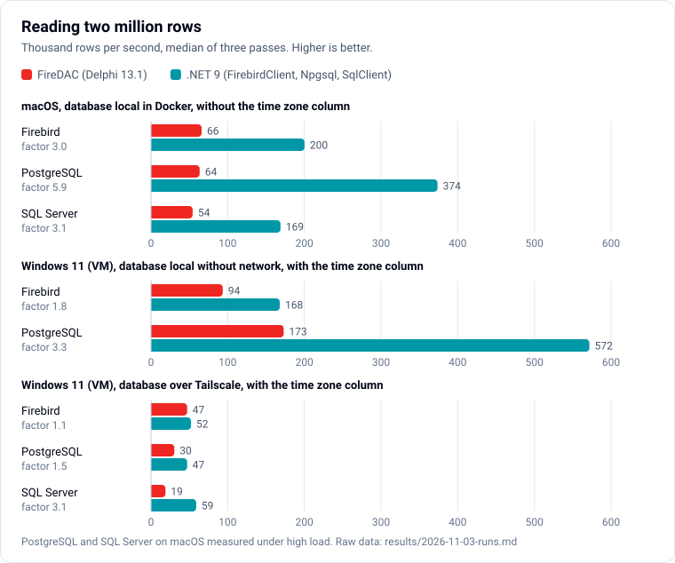
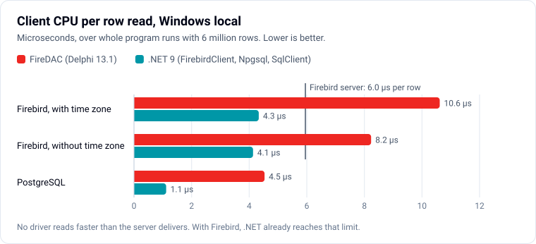
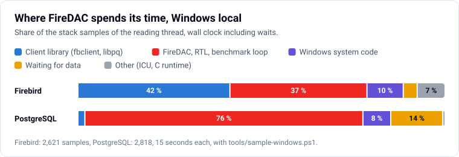
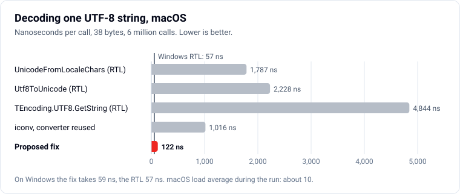

# Database read benchmark: FireDAC and the .NET providers

Sources and data behind the blog post on [developer-experts.net](https://www.developer-experts.net).

Two small programs read the same 2,000,000 rows from Firebird 5, PostgreSQL 18 and SQL Server 2022 and report rows per second plus checksums:

- `delphi/DbReadBench.FireDAC.dpr`: FireDAC, Delphi 13.1, built for Win64 and OSX64. Firebird through the Firebird client library, PostgreSQL through `libpq`, SQL Server through Microsoft ODBC Driver 18.
- `dotnet/Program.cs`: .NET 9 with FirebirdClient 10.3.4, Npgsql 10.0.3 and Microsoft.Data.SqlClient 7.1.1.

Both programs run the same query, inside a snapshot transaction (Firebird concurrency, PostgreSQL repeatable read, SQL Server snapshot), fetch forward-only, and touch the same columns per row: a `BIGINT`, a `NUMERIC(18,2)`, a Unicode string, a timestamp, a `NUMERIC(38,0)` (`INT128` in Firebird) and optionally a timestamp with time zone. The fill scripts produce identical values in all three databases, so the checksums are identical too.

Also in this folder: `delphi/Utf8DecodeBench.dpr` with `delphi/RtlFix.Utf8Decode.pas` (a micro benchmark and a proposed UTF-8 fix for the RTL on macOS), `windows/` (scripts for a local run on Windows without Docker), `tools/` (profiling helpers for macOS and Windows) and `charts/` (the charts of the post and their generator).

## Results

Rows per second, median of three passes, 3 November 2026. All checksums matched in every pass, for every driver. All passes, CPU times, load and profiles: [results/2026-11-03-runs.md](results/2026-11-03-runs.md).



| Setup | Database | FireDAC | .NET | Factor |
| --- | --- | ---: | ---: | ---: |
| macOS 26, Intel i9, databases in local containers, without the time zone column | Firebird 5.0.4 | 66,019 | 200,239 | 3.0 |
| | PostgreSQL 18.6 | 63,507 | 373,683 | 5.9 |
| | SQL Server 2022 | 54,373 | 168,859 | 3.1 |
| Windows 11 VM on the same Mac, databases in the same VM, with the time zone column | Firebird 5.0.4 | 93,618 | 167,961 | 1.8 |
| | Firebird 5.0.4, without the time zone column | 120,057 | 164,984 | 1.4 |
| | PostgreSQL 18.1 | 173,104 | 571,769 | 3.3 |
| Windows 11 VM, databases on the Mac through Tailscale, with the time zone column | Firebird 5.0.4 | 47,147 | 52,084 | 1.1 |
| | PostgreSQL 18.6 | 30,499 | 47,197 | 1.5 |
| | SQL Server 2022 | 18,844 | 58,932 | 3.1 |

The machine was not equally busy during all runs: the Firebird numbers on macOS come from a quiet machine, PostgreSQL and SQL Server on macOS ran with a load average between 10 and 37. Compare the ratios, not the absolute numbers across setups. Over Tailscale the network limits both drivers; the local Windows runs show the difference that the network hides.

## Why FireDAC is slower on macOS

CPU profiles (`sample`) of the FireDAC program, symbols resolved with the linker map (`tools/resolve-ld64-map.ps1`). For Firebird, five seconds without the time zone column (the items overlap slightly, because memory management also shows up inside the other items):

| Share of CPU | Where |
| ---: | --- |
| about 35 % | `iconv_open`, `iconv`, `iconv_close`, called from `System.UnicodeFromLocaleChars` |
| about 25 % | the row fetch inside `libfbclient` (`YResultSet::fetchNext`), including rebuilding the message BLR on every fetch call |
| about 15 % | `malloc` and `free` |
| about 5 % | `INT128` converted to text by `libfbclient` (`IInt128::toString`) and parsed back into a BCD |
| about 4 % | ChaCha wire encryption |
| about 6 % | FireDAC and RTL code itself |

The hot path is `TFDPhysCommand.FetchBase` → `TFDPhysIBCommandBase.FetchRow` → `ProcessColumn` → `TIBVariable.GetData` → `TFDEncoder.Decode` → `System.UnicodeFromLocaleChars`.

The Delphi 13 RTL implements `UnicodeFromLocaleChars` differently per platform: on Windows it calls `MultiByteToWideChar`; on Linux it uses ICU, with a direct UTF-8 path and a cached converter; on macOS it opens an iconv converter for `UTF-16LE`, converts, and closes the converter again on every call, without a cache and without a special case for UTF-8.

The two other databases test that explanation:

- **PostgreSQL** sends UTF-8 text. In the FireDAC profile, iconv takes about 60 % of the CPU time (not counting time spent waiting on the socket). The gap to Npgsql is the largest of the three.
- **SQL Server** sends `NVARCHAR` as UTF-16. In the FireDAC profile, iconv does not appear at all. FireDAC is still about three times slower, but for a different reason: the FireDAC process used only about 68 % of one core while the SQL Server process used a full core. The same factor shows up on Windows, over the network. Something in the ODBC route (packet size, fetch pattern or server-side work) costs here; this was not investigated further.

The .NET providers implement their wire protocols in managed code and decode strings with the runtime's own decoders; none of them needs a native client library.

## Why FireDAC is slower on Windows

On Windows the RTL decodes UTF-8 with `MultiByteToWideChar`, so iconv plays no role. Without a network in between, FireDAC still needs 10.6 µs of client CPU per row with Firebird (8.2 µs without the time zone column) where FirebirdClient needs 4.3 µs, and 4.5 µs with PostgreSQL where Npgsql needs 1.1 µs. With Firebird the .NET provider already runs into the server's limit: the server process needs about 6 µs per row on one core.



The switch `tuned` (`RowsetSize` 10,000, `FetchOptions.Items` without `fiMeta`, `ResourceOptions.SilentMode`, `UpdateOptions.ReadOnly`) changes nothing measurable; neither does `CursorKind := ckDefault` with PostgreSQL. Stack samples of the FireDAC main thread (`tools/sample-windows.ps1`) show where the time goes:



- **Firebird:** 42 % inside `fbclient.dll`, which FireDAC calls through the XSQLDA interface, one `isc_dsql_fetch` per row. Inside FireDAC: every time zone value is converted through `IUtil.decodeTimeStampTzEx` and ICU (9 %), although FireDAC binds these columns to the EXTENDED types that carry the offset; `INT128` goes through text (`IInt128.toString`, ANSI to UTF-16, `FDStr2BCD`; 8 %); the DatS row cache with its notifications takes 7 %, although the dataset is unidirectional.
- **PostgreSQL:** `libpq` takes only 2 %, and FireDAC reads the binary format. With `fmOnDemand` FireDAC declares a server cursor and sends one `FETCH FORWARD <RowsetSize>` per rowset, so server and client take turns; 14 % of the samples wait for the next rowset. A streaming path with `PQsetSingleRowMode` exists in the driver but is never switched on. The row cache takes about 15 %.

These findings, with line references and proposals, are reported to Embarcadero as [RSS-6254](https://embt.atlassian.net/servicedesk/customer/portal/1/RSS-6254). Reading both Quality Portal reports needs a free account there.

## A proposed fix for the RTL on macOS

`delphi/RtlFix.Utf8Decode.pas` decodes UTF-8 to UTF-16 directly, with the contract of `UnicodeFromLocaleChars` (destination length 0 only counts, source length -1 counts the terminator, a too small destination returns 0, U+FFFD per maximal subpart or 0 with `MB_ERR_INVALID_CHARS`) and an ASCII fast path. `delphi/Utf8DecodeBench.dpr` measures it against the RTL and compares the results on eleven test vectors.



Six million decodes of a 38-byte string, nanoseconds per call: on macOS the RTL needs 1,787, the fix 122; on Windows the RTL needs 57, the fix 59. On Windows the results match in 19 of 22 cases, the three differences are only the number of U+FFFD. On macOS they match in 15 of 22: there the RTL drops a valid character before a truncated sequence, returns nothing for a truncated four-byte sequence, turns a value above U+10FFFF into `?` even with `MB_ERR_INVALID_CHARS`, and collapses invalid sequences into one U+FFFD. The full table is in the results file. Reported to Embarcadero as [RSS-6253](https://embt.atlassian.net/servicedesk/customer/portal/1/RSS-6253).

## The time zone trap (Firebird on macOS)

With the `TIMESTAMP WITH TIME ZONE` column FireDAC on macOS did not finish a single Firebird pass within ten minutes. FireDAC has the client library convert every one of these values (see above), and the profile shows `libfbclient` trying to load ICU through `dlopen` for every decoded time stamp (`decodeTimeStampTz` → `TimeZoneUtil::decodeTimeStamp` → `UnicodeUtil::getConversionICU`), failing, and not caching the failure. This happened with the client library taken from the official package without installing the framework. With a regularly installed Firebird client (as on the Windows VM) the test with this column ran normally. PostgreSQL and SQL Server do not hit this trap, because their time zone values never pass through the Firebird client.

## Reproduce

Local throwaway passwords only. Start the database, fill it, run both programs.

**Firebird 5.0.4:**

```bash
docker run -d --name bench-fb -p 53050:3050 -e FIREBIRD_ROOT_PASSWORD=bench -e FIREBIRD_DATABASE=bench.fdb -e FIREBIRD_DATABASE_DEFAULT_CHARSET=UTF8 firebirdsql/firebird:5.0.4-bookworm
docker cp firebird/fill.sql bench-fb:/tmp/ && docker exec bench-fb /opt/firebird/bin/isql -user SYSDBA -password bench -ch UTF8 /var/lib/firebird/data/bench.fdb -i /tmp/fill.sql
```

Connection: `fb 127.0.0.1 53050 /var/lib/firebird/data/bench.fdb SYSDBA bench`

**PostgreSQL 18.6:**

```bash
docker run -d --name bench-pg -p 55433:5432 -e POSTGRES_USER=bench -e POSTGRES_PASSWORD=bench -e POSTGRES_DB=bench postgres:18.6-bookworm
docker cp postgresql/fill.sql bench-pg:/tmp/ && docker exec bench-pg psql -q -U bench -d bench -f /tmp/fill.sql
```

Connection: `pg 127.0.0.1 55433 bench bench bench`

**SQL Server 2022 Developer** (starting it accepts the SQL Server license terms):

```bash
docker run -d --name bench-mssql -p 51433:1433 -e ACCEPT_EULA=Y -e MSSQL_PID=Developer -e MSSQL_SA_PASSWORD=Bench2026xLocal mcr.microsoft.com/mssql/server:2022-latest
docker cp sqlserver/fill.sql bench-mssql:/tmp/ && docker exec bench-mssql /opt/mssql-tools18/bin/sqlcmd -C -S localhost -U sa -P Bench2026xLocal -f 65001 -i /tmp/fill.sql
```

Connection: `mssql 127.0.0.1 51433 bench sa Bench2026xLocal`

**Run:**

- .NET, from `dotnet/`: `dotnet run -c Release -- <connection> [notz]`
- FireDAC: build `delphi/DbReadBench.FireDAC.dproj` for Win64 or OSX64, then `DbReadBench.FireDAC <connection> [vendorlib] [notz] [tuned]`.
  - Firebird: on Windows `fbclient.dll` from a Firebird installation; on macOS a client directory staged with `firebird/stage-fbclient-macos.sh` from the official package `Firebird-5.0.4.1812-0-macos-x64.pkg`, vendorlib `<dir>/lib/libfbclient.dylib`.
  - PostgreSQL: `libpq` 18; on macOS for example `/Applications/Postgres.app/Contents/Versions/18/lib/libpq.5.dylib`, on Windows `libpq.dll` from the EDB binaries with its DLLs on the `PATH`.
  - SQL Server: Microsoft ODBC Driver 18 for SQL Server; on macOS with unixODBC, vendorlib `/usr/local/lib/libodbc.2.dylib`.
- `notz` leaves out the time zone column in both programs. `tuned` changes only FireDAC options: `RowsetSize` 10,000, no `fiMeta`, `SilentMode` and `ReadOnly`.
- Profile on macOS: `sample <pid> 5 -file out.txt` while a pass runs; build once more with a detailed map (`DCC_MapFile=3`) and resolve offsets with `tools/resolve-ld64-map.ps1`.
- Profile on Windows: build with `DCC_MapFile=3` and run `tools/sample-windows.ps1 -FilePath <exe> -Arguments <connection> -MapFile <map>` (PowerShell 7). It suspends the busiest thread of the program about 170 times per second on the test machine, walks the stack with dbghelp and prints self and inclusive shares per function.

On macOS the FireDAC program prints `Unknown` as type name for some fields; the values and checksums are correct.

**Windows without Docker and without network** (PowerShell 7, from `windows/`):

- Firebird: `.\local-firebird.ps1 setup` copies an installed Firebird 5 (default `C:\Program Files\Firebird\Firebird_5_0`) into `%LOCALAPPDATA%\dbbench-local`, gives the copy port 53051, its own IPC name and the SYSDBA password `bench`, and fills `bench.fdb`. The installed service stays untouched. `.\local-firebird.ps1 measure -FireDacExe <exe>` starts the copy, runs FireDAC, FireDAC `tuned` and .NET in turn with client and server CPU times, and stops it again.
- PostgreSQL: `.\local-postgresql.ps1 setup` downloads the official EDB binaries 18.1 as a zip (about 335 MB, checked against its SHA-256, no installation), creates a cluster on port 55434 and fills it. `measure` works as for Firebird.
- Both scripts also have `profile -FireDacExe <exe> -MapFile <map>`, which runs the sampling profiler against a FireDAC pass.

**Charts:** `python3 charts/make_charts.py` redraws the SVG files in German and English from the medians in its source. Each file switches between a light and a dark variant with `prefers-color-scheme`.

## Caveats

- One machine, one table shape. Real workloads with fewer string columns per row will see smaller differences.
- The Windows VM runs on the same Mac. Its runs over Tailscale are network bound; the local runs share the VM's four logical CPUs between program and server.
- Encryption on the wire: Firebird both (FireDAC through `libfbclient` with ChaCha, .NET with Arc4), SQL Server both (TLS), PostgreSQL neither (the container offers no TLS).
- FireDAC ran with default driver settings plus forward-only fetching in rowsets of 2,000. The `tuned` options and `CursorKind := ckDefault` were tried on Windows and made no measurable difference. The .NET programs ran with their defaults (FirebirdClient with `FetchSize` 2,000).

## Trademarks

Delphi, RAD Studio, FireDAC and Embarcadero are trademarks or registered trademarks of Embarcadero Technologies, Inc. or its affiliates in the United States and/or other countries. Firebird is a registered trademark of the Firebird Foundation. PostgreSQL is a registered trademark of the PostgreSQL Community Association of Canada. SQL Server and .NET are trademarks of Microsoft Corporation. All other trademarks are the property of their respective owners. This project is not affiliated with, endorsed by, or sponsored by Embarcadero Technologies, Inc.
