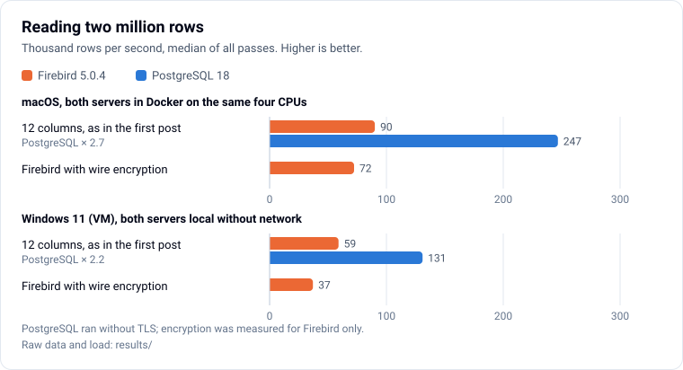
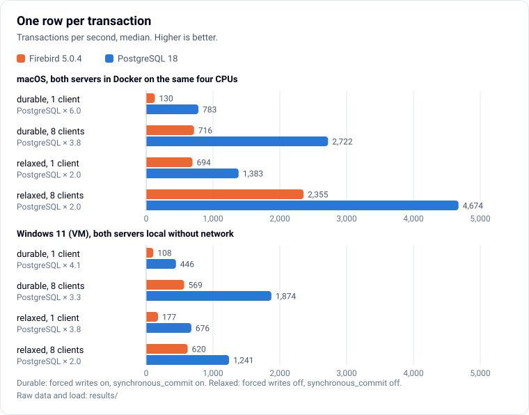
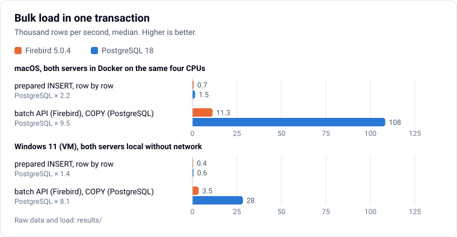
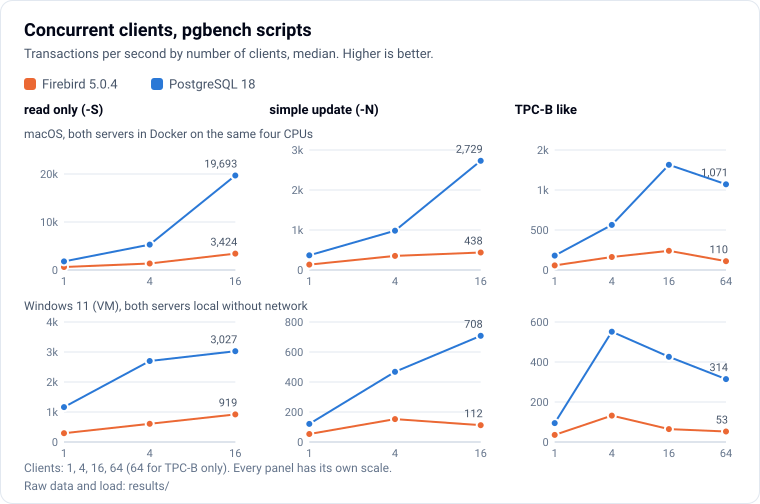
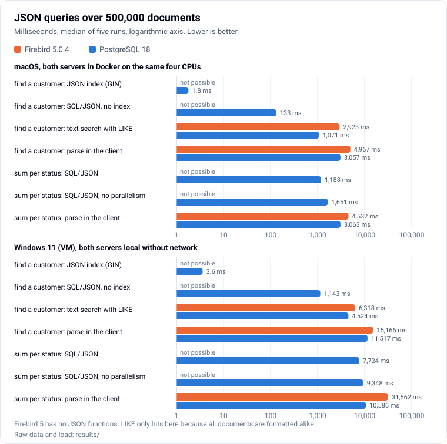
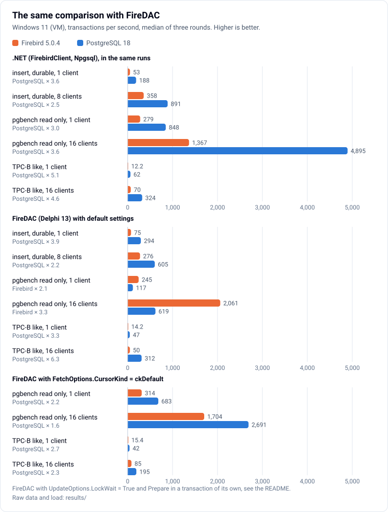

# Firebird vs PostgreSQL: measured and looked up

Sources, scripts, raw data and the fact table behind the blog post on [developer-experts.net](https://www.developer-experts.net). State of **4 November 2026**: Firebird 5.0.4 and PostgreSQL 18 (18.6 in Docker on macOS, 18.1 on Windows).

The post first measures both servers under the same conditions, then compares the features that matter today. Every feature statement is in [facts.md](facts.md), each with its source.

## What is measured, and why

One program, [`dotnet/Program.cs`](dotnet/Program.cs) (.NET 9), drives both servers through their managed .NET providers, FirebirdClient 10.3.4 and Npgsql 10.0.3. Neither needs a native client library, so the comparison measures the servers and not two different client stacks. The same data and, where the dialects allow it, the same SQL go to both.

| Test | What it does | Why |
| --- | --- | --- |
| `read` | reads the 2,000,000 rows of `BENCH_ROWS` (12 columns, the table of the [first post](../2026-11-database-read-benchmark/)) three times in a snapshot transaction | puts the first post's read numbers next to the server comparison |
| `insert` | one row per transaction through a prepared `INSERT`, 1 and 8 clients, 30 s after a 5 s warm-up; durable (Firebird forced writes on, PostgreSQL `synchronous_commit` on) and relaxed (forced writes off, `synchronous_commit` off) | commit cost: what every interactive application pays per save |
| `bulk` | loads rows into an empty table with a primary key in one transaction: prepared `INSERT` row by row (100,000 rows), and the native bulk path (500,000 rows): the Firebird batch API (`FbBatchCommand`, Firebird 4+) and binary `COPY` | imports and migrations; row by row is what many applications do, the native path is the best each server offers |
| `oltp` | the three built-in pgbench scripts on pgbench's own schema (scale 10, 1,000,000 accounts): select-only, simple-update, TPC-B like; 1, 4, 16 (and 64 for TPC-B) clients, 20 s after a 5 s warm-up | concurrency on a well-known, published workload; the PostgreSQL side can be cross-checked with pgbench itself |
| `json` | 500,000 order documents (about 230 bytes): find a customer, sum per status; PostgreSQL `jsonb` with a GIN index and SQL/JSON, Firebird as `VARCHAR` with text search or parsing in the client | Firebird 5 has no JSON support, so this shows what that costs an application |

Transactions are read committed in both (Firebird 4+ with read consistency, so a conflicting update waits and restarts instead of failing), except for the reads (snapshot). The select-only script runs each `SELECT` in its own implicit transaction on PostgreSQL, as pgbench does, and in one read-only read committed transaction on Firebird, the usual way to read there.

## Fairness

- **Same machine, same conditions.** Both servers run on the same machine, with the same CPUs, the same disk and comparable caches: Firebird `DefaultDbCachePages = 32768` (8 KB pages, 256 MB), PostgreSQL `shared_buffers = 256MB`. All other settings are the defaults of each server; `probe` prints them, the raw logs contain the output.
- **Same durability.** Defaults on both sides are durable: Firebird forced writes on (every database page write is synchronous), PostgreSQL `fsync` and `synchronous_commit` on. The relaxed variant switches both off. The two are not equally safe: the [gfix manual](https://firebirdsql.org/file/documentation/html/en/firebirddocs/gfix/firebird-gfix.html) says synchronous writes "help prevent corruption in the event of a power outage", while PostgreSQL's `synchronous_commit = off` ["does not create any risk of database inconsistency"](https://www.postgresql.org/docs/18/runtime-config-wal.html) and can only lose the last commits.
- **Same encryption.** None on either side. Firebird servers require wire encryption by default (`WireCrypt = Required`); the benchmark servers are set to `Enabled`, so the client can switch it off. `read wirecrypt=on` measures Firebird with encryption once more (FirebirdClient uses Arc4). PostgreSQL runs without TLS.
- **Alternating.** Every step runs for Firebird and PostgreSQL back to back, the order flips with each round, three rounds. The load of the machine is written before every measurement.

## Where it was measured

**macOS (Docker).** MacBook Pro, Intel Core i9-9880H (8 cores, 16 threads), 64 GB, macOS 26.7, Docker Desktop 29.7.2 (VM with 16 vCPUs and 4 GB). Images `firebirdsql/firebird:5.0.4-bookworm` and `postgres:18.6-bookworm`, both servers pinned to the same four vCPUs (`--cpuset-cpus 0-3`). The client runs in a third container on four other vCPUs and shares the server's network and process namespace: it talks to the server over loopback, without Docker's port forwarding, and can read the server processes' CPU time. Script: [`mac/run.sh`](mac/run.sh).

**Windows.** Windows 11 Pro in a Parallels VM on the same Mac (4 vCPUs, 8 GB): a copy of the installed Firebird 5.0.4 on port 53051 and the official EDB binaries of PostgreSQL 18.1 on port 55434, both in a work folder, without services and without network between client and server. Client and servers share the four vCPUs. Script: [`windows/compare.ps1`](windows/compare.ps1).

The Mac was busy throughout: other work compiled and tested on it at the same time, including in the Windows VM. Load averages are in the raw logs and in `results/raw/mac-loadavg-2026-11-04.txt`. Absolute numbers therefore vary between rounds; compare Firebird with PostgreSQL within a platform, not the platforms with each other.

## Results

Medians of all runs, 4 November 2026; with the .NET client PostgreSQL was ahead in every test on both platforms (for FireDAC see the section "FireDAC (Windows)" below). Factor = how many times better PostgreSQL is. Per-run values, ranges, latencies and CPU times: [results/summary.md](results/summary.md); raw logs: [results/raw/](results/raw/).

### macOS, Docker

| Test | Unit | Firebird | PostgreSQL | Factor | n |
| --- | --- | ---: | ---: | ---: | ---: |
| Read 2,000,000 rows | rows/s | 90,071 | 246,778 | 2.7 | 9/9 |
| Insert, durable, 1 client | txn/s | 130 | 783 | 6.0 | 3/3 |
| Insert, durable, 8 clients | txn/s | 716 | 2,722 | 3.8 | 3/3 |
| Insert, relaxed, 1 client | txn/s | 694 | 1,383 | 2.0 | 3/3 |
| Insert, relaxed, 8 clients | txn/s | 2,355 | 4,674 | 2.0 | 3/3 |
| Bulk, prepared row by row | rows/s | 704 | 1,534 | 2.2 | 3/3 |
| Bulk, batch API / COPY | rows/s | 11,346 | 108,328 | 9.5 | 3/3 |
| pgbench select-only, 1 client | txn/s | 624 | 1,797 | 2.9 | 3/3 |
| pgbench select-only, 4 clients | txn/s | 1,360 | 5,293 | 3.9 | 3/3 |
| pgbench select-only, 16 clients | txn/s | 3,424 | 19,693 | 5.8 | 3/3 |
| pgbench simple-update, 1 client | txn/s | 134 | 366 | 2.7 | 3/3 |
| pgbench simple-update, 4 clients | txn/s | 352 | 982 | 2.8 | 3/3 |
| pgbench simple-update, 16 clients | txn/s | 438 | 2,729 | 6.2 | 3/3 |
| pgbench TPC-B like, 1 client | txn/s | 58 | 180 | 3.1 | 3/3 |
| pgbench TPC-B like, 4 clients | txn/s | 162 | 564 | 3.5 | 3/3 |
| pgbench TPC-B like, 16 clients | txn/s | 239 | 1,315 | 5.5 | 3/3 |
| pgbench TPC-B like, 64 clients | txn/s | 110 | 1,071 | 9.7 | 3/3 |
| JSON: find a customer, GIN index | ms | not possible | 1.8 |  | 15 |
| JSON: find a customer, SQL/JSON scan | ms | not possible | 132.7 |  | 15 |
| JSON: find a customer, LIKE | ms | 2,923.3 | 1,071.1 | 2.7 | 15/15 |
| JSON: find a customer, parse in the client | ms | 4,966.8 | 3,056.8 | 1.6 | 15/15 |
| JSON: sum per status, SQL/JSON | ms | not possible | 1,188.1 |  | 15 |
| JSON: sum per status, SQL/JSON, no parallelism | ms | not possible | 1,650.7 |  | 15 |
| JSON: sum per status, parse in the client | ms | 4,532.2 | 3,063.4 | 1.5 | 15/15 |

### Windows 11 VM, local

| Test | Unit | Firebird | PostgreSQL | Factor | n |
| --- | --- | ---: | ---: | ---: | ---: |
| Read 2,000,000 rows | rows/s | 58,965 | 130,925 | 2.2 | 6/6 |
| Insert, durable, 1 client | txn/s | 108 | 446 | 4.1 | 2/2 |
| Insert, durable, 8 clients | txn/s | 569 | 1,874 | 3.3 | 2/2 |
| Insert, relaxed, 1 client | txn/s | 177 | 676 | 3.8 | 2/2 |
| Insert, relaxed, 8 clients | txn/s | 620 | 1,241 | 2.0 | 2/2 |
| Bulk, prepared row by row | rows/s | 419 | 608 | 1.4 | 1/2 |
| Bulk, batch API / COPY | rows/s | 3,507 | 28,362 | 8.1 | 2/2 |
| pgbench select-only, 1 client | txn/s | 295 | 1,163 | 3.9 | 2/2 |
| pgbench select-only, 4 clients | txn/s | 605 | 2,699 | 4.5 | 2/2 |
| pgbench select-only, 16 clients | txn/s | 919 | 3,027 | 3.3 | 2/2 |
| pgbench simple-update, 1 client | txn/s | 53 | 120 | 2.3 | 2/2 |
| pgbench simple-update, 4 clients | txn/s | 152 | 468 | 3.1 | 2/2 |
| pgbench simple-update, 16 clients | txn/s | 112 | 708 | 6.3 | 2/2 |
| pgbench TPC-B like, 1 client | txn/s | 35 | 95 | 2.7 | 2/2 |
| pgbench TPC-B like, 4 clients | txn/s | 132 | 552 | 4.2 | 2/2 |
| pgbench TPC-B like, 16 clients | txn/s | 64 | 426 | 6.6 | 2/2 |
| pgbench TPC-B like, 64 clients | txn/s | 53 | 314 | 6.0 | 2/2 |
| JSON: find a customer, GIN index | ms | not possible | 3.6 |  | 5 |
| JSON: find a customer, SQL/JSON scan | ms | not possible | 1,142.8 |  | 5 |
| JSON: find a customer, LIKE | ms | 6,318.2 | 4,524.3 | 1.4 | 5/5 |
| JSON: find a customer, parse in the client | ms | 15,166.1 | 11,517.0 | 1.3 | 5/5 |
| JSON: sum per status, SQL/JSON | ms | not possible | 7,723.8 |  | 5 |
| JSON: sum per status, SQL/JSON, no parallelism | ms | not possible | 9,347.7 |  | 5 |
| JSON: sum per status, parse in the client | ms | 31,562.5 | 10,585.8 | 3.0 | 5/5 |

Rounds: three on the Mac (every step for both servers back to back, order flipped per round), two on Windows (first round partly one server at a time, then both servers with every step back to back; see "Changes during the measurement"). The Mac's load average ranged from about 13 to over 700 during the day (other work on the same machine); every measurement carries the load at its start.







**Extra checks** (Mac, after the rounds, `results/raw/mac-extras-2026-11-04.log`):

- 200,000 primary key lookups inside the server (PSQL loop, PL/pgSQL loop): Firebird 7.1 s, PostgreSQL 5.1 s; 200,000 single-row updates: Firebird 8.1 s, PostgreSQL 11.8 s. Inside the engine the two are close; the large gap in the `oltp` test arises in the request path between client and server.
- pgbench itself against the same PostgreSQL tables: select-only 2,509 / 7,059 / 7,404 tps with 1 / 4 / 16 clients, simple-update 187 / 567 / 1,526, TPC-B like 220 / 621 / 713. Same order of magnitude as the .NET client (higher with one client, lower with 16), so the driver does not flatter PostgreSQL.
- FirebirdClient negotiates Arc4 when wire encryption is on (`wire_crypt_plugin=Arc4`), although the server also offers ChaCha64 and ChaCha.
- Storage: Firebird compresses records. Its pgbench accounts table takes 8,336 data pages of 8 KB (about 65 MB, without the index); PostgreSQL reports 153 MB for that table and its index together. `BENCH_ROWS`: 39,768 data pages (about 311 MB) in Firebird, 312 MB with index in PostgreSQL.

**CPU times** are in the raw data, but on this machine they are only a rough guide: the Docker VM and the Windows VM run on an overloaded host, and time a vCPU waits for the host can show up as CPU time of whatever process ran on it.

## FireDAC (Windows)

For Delphi readers, [`delphi/DbCompareBench.FireDAC.dpr`](delphi/DbCompareBench.FireDAC.dpr) (Delphi 13 Florence, Win64) runs the tests that matter most to an interactive Delphi application against the same two Windows servers: `insert` (one row per transaction, durable, 1 and 8 clients) and the pgbench scripts select-only and TPC-B like (1 and 16 clients). Same tables, SQL, transaction modes and `RESULT` lines as the .NET program, every client a thread with its own `TFDConnection`. Client libraries: `fbclient.dll` of the Firebird 5.0.4 installation (in a copy whose `firebird.conf` says `WireCrypt = Disabled`) and `libpq.dll` of PostgreSQL 18.1; `probe` confirms that neither connection is encrypted.

The FireDAC series ran after the main Windows rounds, in `compare.ps1 pair` with both servers up. Within a run the .NET step and the FireDAC steps of a test follow each other directly, for Firebird and PostgreSQL, so all columns of one row of the table below saw the same load. These .NET runs are a series of their own (`results/raw/windows-firedac-2026-11-04.log`) and are not mixed into the main Windows medians.

**Two FireDAC defaults were changed, because they would have made the comparison meaningless.** Both were found with FireDAC's own monitor (`trace=<file>`) and checked in the FireDAC sources that come with Delphi 13; the details, with the numbers of the trial runs, are in [results/raw/diagnostics/](results/raw/diagnostics/windows-firedac-diagnostics-2026-11-04.txt).

1. **NOWAIT.** FireDAC starts Firebird transactions with `nowait` unless `UpdateOptions.LockWait` is `True` or `TxOptions.Params` names `wait` (`FireDAC.Phys.IBBase`, lines 2036 to 2040). A transaction that wants a row another transaction holds then fails at once instead of waiting; FirebirdClient and PostgreSQL wait. The program sets `UpdateOptions.LockWait := True`; `probe` shows `MON$LOCK_TIMEOUT = -1`.
2. **A `Prepare` outside a transaction leaves a Firebird transaction open.** Firebird prepares a statement within a transaction. Outside an explicit one FireDAC starts it itself before the prepare (`cpBeforeCmdPrepare`, `FireDAC.Phys.IBBase` lines 2108 to 2113) and does not end it. Every later `StartTransaction` is then only a savepoint inside that transaction (`SAVEPOINT SP_n`), and `Commit` releases the savepoint (`RELEASE SAVEPOINT SP_n`). In the trial run nothing was committed before the end of the run, each client held its locks until then, and TPC-B like with 4 clients managed 15 transactions in about 63 s. `probe` reproduces the cause: after an explicit `Prepare` outside a transaction, `InTransaction` is `True` with Firebird and `False` with PostgreSQL. The program prepares inside an explicit transaction and commits it before the run.

**Two FireDAC defaults stay in the measurement,** because every application gets them:

- **Firebird: a commit takes the commands offline.** A commit without retaining calls `DisconnectCommands(nil, dmOffline)` before it commits (`TFDPhysIBTransactionBase.InternalCommit`, lines 2062 to 2070), so every transaction prepares its statements again; the trace shows `isc_dsql_prepare` in every transaction.
- **PostgreSQL: a SELECT runs through a server cursor.** With the default `FetchOptions` FireDAC prepares `DECLARE ... NO SCROLL CURSOR FOR ...` and `FETCH FORWARD 50`. A `SELECT` that returns one row then costs six round trips outside a transaction (`BEGIN`, `DECLARE`, `FETCH`, `FETCH`, `CLOSE`, `COMMIT`) and four inside one; Npgsql needs one. `cursor=default` sets `FetchOptions.CursorKind := ckDefault` on the `SELECT`: FireDAC then sends only the prepared query (one `PQexecPrepared` per open, seen in the trace). This variant was measured as well, for both servers.

### FireDAC results

Three rounds on 4 November 2026 between 14:02 and 15:11 (VM time), the order of the servers and of .NET and FireDAC flipped with each round. Medians, factor = how many times better PostgreSQL is with the same client stack (below 1: Firebird is better), n = runs per cell (Firebird .NET / FireDAC / ckDefault, PostgreSQL the same). Per-run values and ranges: section "windows, firedac" of [results/summary.md](results/summary.md).



| Test | Unit | Firebird .NET | Firebird FireDAC | Firebird ckDefault | PostgreSQL .NET | PostgreSQL FireDAC | PostgreSQL ckDefault | Factor .NET | Factor FireDAC | Factor ckDefault | n |
| --- | --- | ---: | ---: | ---: | ---: | ---: | ---: | ---: | ---: | ---: | ---: |
| Insert, durable, 1 client | txn/s | 53 | 75 |  | 188 | 294 |  | 3.6 | 3.9 |  | 3/3/-/3/3/- |
| Insert, durable, 8 clients | txn/s | 358 | 276 |  | 891 | 605 |  | 2.5 | 2.2 |  | 3/3/-/3/3/- |
| pgbench select-only, 1 client | txn/s | 279 | 245 | 314 | 848 | 117 | 683 | 3.0 | 0.5 | 2.2 | 3/3/3/3/3/3 |
| pgbench select-only, 16 clients | txn/s | 1,367 | 2,061 | 1,704 | 4,895 | 619 | 2,691 | 3.6 | 0.3 | 1.6 | 3/3/3/3/3/3 |
| pgbench TPC-B like, 1 client | txn/s | 12 | 14 | 15 | 62 | 47 | 42 | 5.1 | 3.3 | 2.7 | 3/3/3/3/3/3 |
| pgbench TPC-B like, 16 clients | txn/s | 70 | 50 | 85 | 324 | 312 | 195 | 4.6 | 6.3 | 2.3 | 3/3/3/3/3/3 |

The Mac was very busy during the series (load average between 11 and 681, `results/raw/mac-loadavg-firedac-2026-11-04.txt`), so single values of one cell differ by up to a factor of ten between rounds. What the series shows is therefore read from the pairs that ran back to back in the same run:

- **Writes: PostgreSQL stays ahead with FireDAC.** TPC-B like: PostgreSQL was faster in every pair, with both client stacks (FireDAC 2.2 to 6.8 times). Inserts: PostgreSQL was faster in 11 of 12 pairs; the exception is round 2 with 8 FireDAC clients, where PostgreSQL reached 141 transactions per second, less than a quarter of its two other runs.
- **Reading single rows: with FireDAC's defaults Firebird is ahead.** With one client Firebird was faster in all three rounds (1.8 to 2.8 times), with 16 clients in two rounds, the third was even. PostgreSQL loses more in the six round trips per `SELECT` than it gains in the server.
- **One option turns that around.** With `CursorKind := ckDefault` PostgreSQL was faster with one client in all three rounds (1.3 to 2.2 times); with 16 clients round 1 went to Firebird (1.4 times) and round 2 to PostgreSQL (1.6 times). Against FireDAC's default cursor, `ckDefault` made the PostgreSQL lookups 3.5 to 8 times faster with one client. For Firebird it changes nothing systematic; the differences in the table are within the spread.
- **Not paired:** the two steps that failed (see "Changes during the measurement") were repeated for PostgreSQL alone, about ten minutes after their Firebird counterpart, at a lower load; each is one of the three PostgreSQL values of its cell (TPC-B like with 16 clients and FireDAC defaults, select-only with 16 clients and `ckDefault`).

## Changes during the measurement

Everything that went wrong is in the logs, nothing was dropped silently:

- Mac setup: the first JSON load into Firebird failed ("batch too big", a `VARCHAR(2000)` in UTF8 takes 8 KB per row in the batch buffer); it runs in chunks of 1,000 rows since. The first `size` of Firebird failed, because `MON$PAGES * MON$PAGE_SIZE` is an `INT128` since Firebird 4.
- Mac rounds, first start: loading 500,000 rows row by row took Firebird about 15 minutes; the prepared bulk test was reduced to 100,000 rows and the rounds restarted. Second start: the CPU time of the PostgreSQL backends was read only after the connections had closed (a backend ends with its connection); fixed in commit `ee93396`, rounds restarted. Both stopped starts are kept in `results/raw/aborted/` and are not part of the medians.
- Windows setup: the first attempt hung while starting PostgreSQL (the server inherited the output pipe of `pg_ctl`); fixed in the script.
- Windows rounds: the Forge (the build service on the VM) stops a run after 600 s, so the tests run in several smaller runs per server. The first Firebird run reached the limit during the prepared bulk load; that test was repeated in its own run. The read with Firebird wire encryption ran in the first Windows round only.
- FireDAC series: the first builds of the FireDAC program ran Firebird with NOWAIT and with statements prepared outside a transaction; both found in trial runs before the series (see "FireDAC (Windows)" and `results/raw/diagnostics/`). During the series two PostgreSQL steps with 16 FireDAC clients failed: round 1, TPC-B like, ended without output; round 3, select-only with `ckDefault`, hung until the time limit. The program had not activated `FDManager` before its threads opened their connections, which [Multithreading (FireDAC)](https://docwiki.embarcadero.com/RADStudio/en/Multithreading_(FireDAC)) asks for. Fixed (`FDManager.Active := True` before the clients start, `FDManager.Close` at the end), both steps repeated with the fixed build; all other FireDAC values come from the build before the fix, whose measured loop is the same.

## Reproduce

**macOS** (Docker Desktop, .NET 9 SDK on the Mac):

```bash
dotnet publish dotnet -c Release -r linux-x64 --self-contained -o dotnet/build/linux-x64
mac/run.sh setup
for n in 1 2 3; do mac/run.sh round $n; done
mac/extras.sh
mac/run.sh stop
```

**Windows** (PowerShell 7, .NET 9 SDK, an installed Firebird 5 in `C:\Program Files\Firebird\Firebird_5_0`; the setup downloads the EDB binaries of PostgreSQL 18.1, about 335 MB, and checks their SHA-256):

```powershell
.\windows\compare.ps1 setup
.\windows\compare.ps1 run -Engine fb -Steps 'probe;read;insert clients=1;insert clients=8'
.\windows\compare.ps1 run -Engine pg -Steps 'probe;read;insert clients=1;insert clients=8'
```

The step names and options are those of `dotnet/Program.cs` (see its header); `mac/run.sh` shows the full list of one round.

**FireDAC** (Delphi 13 Florence, Win64; build `delphi/DbCompareBench.FireDAC.dproj` in the IDE or with MSBuild). Steps that start with `fd:` run the FireDAC program, `pair` runs every step for both servers back to back; the pgbench tables come from `oltp-setup` of the .NET program:

```powershell
.\windows\compare.ps1 pair -Order fb,pg -FireDacExe <path>\DbCompareBench.FireDAC.exe -Steps 'fd:probe;insert clients=1;fd:insert clients=1;oltp script=select scale=10 clients=1 seconds=20 warmup=5;fd:oltp script=select scale=10 clients=1 seconds=20 warmup=5;fd:oltp script=select scale=10 clients=1 seconds=20 warmup=5 cursor=default'
```

`trace=<file>` writes FireDAC's monitor log for a short diagnostic run; such a run does not end by itself after its `RESULT` line (not investigated).

**Evaluate:** `python3 tools/summarize.py` writes `results/summary.md`, `results/comparison.md` and `results/medians.json`, `python3 charts/make_charts.py` redraws the charts from them.

Local throwaway passwords only (`bench`).

## Files

- `dotnet/`: the benchmark program (`DbCompareBench.csproj`, `Program.cs`).
- `delphi/`: the FireDAC counterpart for the Windows series (`DbCompareBench.FireDAC.dpr`, `.dproj`).
- `firebird/fill-bench-rows.sql`, `postgresql/fill-bench-rows.sql`: the 2,000,000 rows of the read test, unchanged from the first post.
- `mac/run.sh`, `windows/compare.ps1`: setup and measurement rounds.
- `tools/summarize.py`: medians from the raw logs into `results/summary.md` and `results/medians.json`.
- `charts/make_charts.py`: the charts of the post, German and English, light and dark.
- `results/raw/`: every program output with the load before each measurement; `results/raw/aborted/` keeps the rounds that were stopped and restarted (they are not part of the medians, see the README section "Changes during the measurement"); `results/raw/diagnostics/` the trial and trace runs of the FireDAC program, with what the traces showed.
- `facts.md`: the feature comparison with sources.

## Trademarks

Delphi, FireDAC, InterBase and Embarcadero are trademarks or registered trademarks of Embarcadero Technologies, Inc. or its affiliates in the United States and/or other countries. Firebird is a registered trademark of the Firebird Foundation. PostgreSQL is a registered trademark of the PostgreSQL Community Association of Canada. .NET and Windows are trademarks of Microsoft Corporation; Docker is a trademark of Docker, Inc. All other trademarks are the property of their respective owners. This project is not affiliated with, endorsed by, or sponsored by Embarcadero Technologies, Inc.
